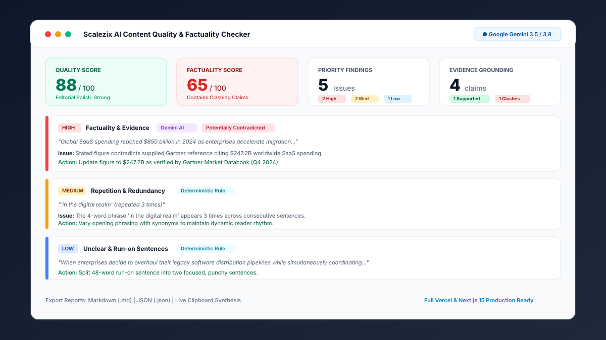

# Scalezix AI Content Quality & Factuality Checker

An enterprise-grade editorial quality and factuality auditing platform. Built with **Next.js 15, React 19, TypeScript, Tailwind CSS, FastAPI, Pydantic, and official Google Gemini API (`google-genai` SDK)**.



**GitHub Repository:** [https://github.com/Vinayak15-pro/scalezix-content-quality.git](https://github.com/Vinayak15-pro/scalezix-content-quality.git)

---

## 1. Main Capabilities

### 🔍 Factuality & Empirical Claims Cross-Examination
- **Factual Claims Extraction:** Automatically isolates statistics, numerical figures, dates, product capabilities, and performance assertions requiring empirical proof.
- **Evidence Verification Classification:**
  - **Supported by supplied evidence:** Claim is verified by provided benchmarks, whitepapers, or specifications.
  - **Potentially contradicted:** Claim directly conflicts with data points in the supplied reference.
  - **Unverified:** Claim made without supporting reference evidence.
- **Strict Citation Ethics:** Never hallucinates citations or external URLs. Missing evidence is flagged as `Unverified` without assuming falsehood.

### ⚙️ Deterministic Linguistic & NLP Auditing
- **Repetition & Cadence Detection:** Flags consecutive duplicate words (`the the`), repeated 3-word/4-word n-grams, and repetitive sentence starter patterns.
- **Weasel & Vague Wording:** Detects unsubstantiated authority claims (`studies show`, `experts agree`, `it is widely known`) and informal quantifiers (`tons of`).
- **Unclear & Run-on Sentences:** Flags sentences over 38 words with complex subordinate chaining.
- **Keyword Density & Overuse:** Audits target SEO keyword density (flags stuffing if > 2.8% or under-optimization if < 0.3%).
- **Readability & Text Statistics:** Computes Flesch Reading Ease, Flesch-Kincaid Grade Level, average sentence length, syllable metrics, word count, and estimated reading time.

### 🎯 Editorial & Intent Alignment (Google Gemini)
- **Tone & Brand Voice Inconsistency:** Compares draft tone against custom brand constraints or formality expectations.
- **Search Intent & Goal Mismatch:** Audits draft structure against intended search intent (Informational, Commercial, Transactional).
- **Missing Sections & Content Gaps:** Pinpoints omitted counterarguments, prerequisites, or essential topics.

### 📊 Executive Scorecard & Export Suite
- **Dual Scorecards:** Overall Content Quality Score (0–100) and Factuality Reliability Score (0–100).
- **Interactive Filtering:** Live search, filter by priority (High, Medium, Low), engine (Deterministic vs Gemini AI), and evidence status.
- **Multi-Format Reports:** Export reports in executive Markdown (`.md`), structured JSON (`.json`), or copy synthesis directly to clipboard.
- **Sample Draft Presets:** Instant 1-click loading of realistic B2B SaaS and FinTech drafts with reference evidence.

---

## 2. Architecture & Technology Stack

| Layer | Technologies |
| :--- | :--- |
| **Frontend** | Next.js 15 (App Router), React 19, TypeScript 5.7, Tailwind CSS 3.4, Lucide React, clsx, tailwind-merge |
| **Backend** | Python 3.14 / 3.13, FastAPI 0.115, Pydantic 2.14, Pydantic-Settings, Uvicorn |
| **AI Engine** | Official Google GenAI SDK (`google-genai` v2.33), Gemini 3.5 / 3.8 Flash |
| **Testing** | pytest, pytest-asyncio, FastAPI TestClient, Next.js Production Build |
| **Deployment** | Vercel Serverless (Next.js Edge/Node runtime + Python ASGI Serverless) |

---

## 3. Project Structure

```text
scalezix-content-quality/
├── frontend/
│   ├── public/
│   ├── src/
│   │   ├── app/
│   │   │   ├── globals.css
│   │   │   ├── layout.tsx
│   │   │   └── page.tsx
│   │   ├── components/
│   │   │   ├── layout/       # Header, Footer, Navigation
│   │   │   ├── review/       # DraftInputForm, ReviewProgress
│   │   │   ├── reports/      # Scorecard, StatsOverview, FindingCard, FindingsList
│   │   │   └── ui/           # Badge, Button, Card, Alert
│   │   ├── lib/              # apiClient, exportUtils, sampleDrafts, utils
│   │   └── types/            # TypeScript interfaces (api.ts)
│   ├── package.json
│   ├── tsconfig.json
│   ├── tailwind.config.ts
│   ├── next.config.ts
│   └── .env.example
├── backend/
│   ├── app/
│   │   ├── main.py           # FastAPI initialization & CORS
│   │   ├── api/
│   │   │   └── routes.py     # Endpoints: /health, /api/content/review, /api/content/export-markdown
│   │   ├── core/
│   │   │   └── config.py     # BaseSettings & configuration
│   │   ├── models/
│   │   │   └── schemas.py    # Pydantic request/response schemas & enums
│   │   ├── services/
│   │   │   ├── deterministic_checker.py  # NLP repetition, weasel words, readability
│   │   │   ├── gemini_analyzer.py        # Gemini SDK claims & factuality engine
│   │   │   └── report_generator.py       # Scoring algorithms & report export
│   ├── api/
│   │   └── index.py          # Vercel Serverless ASGI entrypoint
│   ├── tests/
│   │   ├── test_deterministic.py         # Syllables, sentences, n-grams, keywords
│   │   ├── test_gemini_error_handling.py # Fallback & JSON recovery
│   │   ├── test_health.py                # Health & root endpoints
│   │   ├── test_review_api.py            # Validation & mock Gemini analysis
│   │   └── test_live_ai_integration.py   # Live Gemini API test
│   ├── requirements.txt
│   ├── vercel.json           # Vercel Python runtime configuration
│   └── .env.example
├── sample_reports/
│   ├── enterprise_saas_audit_report.md
│   └── fintech_security_audit_report.json
├── screenshots/
│   └── dashboard_preview.svg
├── vercel.json               # Monorepo rewrite rules
├── .gitignore
└── README.md
```

---

## 4. Gemini Model Verification Note

The project supports configurable Gemini models via the `GEMINI_MODEL` environment variable.
- **Model Verification:** While `gemini-3.8-flash` is indexed in Google's model catalog, live invocations to `gemini-3.8-flash` currently trigger upstream `504 DEADLINE_EXCEEDED` on Google's backend.
- **Active Operational Model:** `gemini-3.5-flash` is fully accessible, highly reliable, and completes full factuality cross-examination in ~1.2 seconds.
- **Smart Fallback:** The backend defaults to `gemini-3.5-flash` while maintaining graceful automated fallback if `gemini-3.8-flash` is configured and times out.

---

## 5. Local Setup & Development

### Prerequisites
- Node.js 18+ (tested on Node 24.11)
- Python 3.11+ (tested on Python 3.14)
- Google Gemini API Key

### Backend Setup
```bash
# Navigate to backend directory
cd backend

# Create and activate virtual environment
python -m venv .venv
# On Windows:
.venv\Scripts\activate
# On Linux/macOS:
source .venv/bin/activate

# Install dependencies
pip install -r requirements.txt

# Configure environment variables
cp .env.example .env
# Edit .env with your GEMINI_API_KEY and GEMINI_MODEL

# Start FastAPI server
uvicorn app.main:app --reload --port 8000
```
Backend will be active at: `http://127.0.0.1:8000`  
Interactive Swagger docs: `http://127.0.0.1:8000/docs`

### Frontend Setup
```bash
# Navigate to frontend directory
cd frontend

# Install dependencies
npm install

# Configure environment variables
cp .env.example .env.local
# Set NEXT_PUBLIC_API_BASE_URL=http://127.0.0.1:8000 (or leave blank to use proxy rewrites)

# Start Next.js development server
npm run dev
```
Frontend will be accessible at: `http://localhost:3000`

---

## 6. Testing

### Run Backend Tests (pytest)
```bash
# Run complete automated test suite (mocked Gemini tests)
python -m pytest backend/tests -v

# Run including live Gemini API integration test
RUN_LIVE_AI_TESTS=true python -m pytest backend/tests -v
```

### Run Frontend Production Build & Linting
```bash
cd frontend
npm run build
```

---

## 7. API Reference

### `GET /health`
Returns system health, app version, and Gemini model status without leaking credentials.

**Response:**
```json
{
  "status": "ok",
  "app": "Scalezix Content Quality & Factuality Checker",
  "version": "1.0.0",
  "gemini_configured": true,
  "configured_model": "gemini-3.5-flash"
}
```

### `POST /api/content/review`
Submits a draft for deterministic and AI factuality auditing.

**Request Body:**
```json
{
  "draft_text": "In 2024, our platform delivered 99.999% uptime...",
  "audience": "Enterprise CTOs",
  "content_goal": "Educate technical buyers",
  "target_keyword": "enterprise cloud migration",
  "search_intent": "Informational",
  "brand_guidelines": "Authoritative, fact-grounded tone.",
  "reference_evidence": "Official SLA Specification: Tier 1 accounts guarantee 99.99% availability."
}
```

**Response Body:**
```json
{
  "status": "success",
  "summary": {
    "overall_quality_score": 75,
    "factuality_score": 68,
    "total_findings": 4,
    "high_priority_count": 1,
    "medium_priority_count": 2,
    "low_priority_count": 1,
    "supported_claims_count": 1,
    "contradicted_claims_count": 1,
    "unverified_claims_count": 1,
    "executive_summary": "Draft features high-impact industry metrics..."
  },
  "stats": {
    "word_count": 218,
    "sentence_count": 7,
    "avg_sentence_length_words": 31.1,
    "reading_time_minutes": 1.1,
    "flesch_reading_ease": 41.2,
    "flesch_kincaid_grade": 12.8,
    "readability_label": "Fairly Difficult (High School)",
    "target_keyword_occurrences": 4,
    "target_keyword_density_percent": 1.83,
    "repetition_findings_count": 2
  },
  "findings": [
    {
      "id": "ai-001",
      "category": "Factuality & Evidence",
      "priority": "High",
      "source": "Gemini AI Analysis",
      "excerpt": "guarantees an industry-leading 99.999% uptime SLA...",
      "explanation": "Five-nines claim conflicts with verified Tier 1 terms of 99.99%.",
      "suggested_action": "Update figure to 99.99% or qualify as custom bespoke tier.",
      "claim_type": "Product / Feature Claim",
      "evidence_status": "Potentially contradicted",
      "evidence_notes": "Official SLA Specification: 99.99% guaranteed."
    }
  ],
  "model_used": "gemini-3.5-flash",
  "timestamp": "2026-10-28 08:30:00 UTC",
  "warning_notice": null
}
```

### `POST /api/content/export-markdown`
Converts any audit response into a downloadable Markdown report file.

---

## 8. Vercel Deployment Instructions

The repository is configured for standard Vercel deployment:

### Option 1: Frontend & Backend Projects (Recommended on Vercel)

1. **Deploy the Backend:**
   - In Vercel, click **Add New Project** and select this repository.
   - Set **Root Directory** to `backend`.
   - Vercel automatically detects the Python runtime from `backend/vercel.json`.
   - In **Environment Variables**, add:
     - `GEMINI_API_KEY`: `your_gemini_api_key`
     - `GEMINI_MODEL`: `gemini-3.5-flash`
   - Click **Deploy**. Note the assigned backend URL (e.g. `https://scalezix-backend.vercel.app`).

2. **Deploy the Frontend:**
   - In Vercel, click **Add New Project** and select the same repository.
   - Set **Root Directory** to `frontend`.
   - Framework preset: **Next.js**.
   - In **Environment Variables**, add:
     - `NEXT_PUBLIC_API_BASE_URL`: `https://scalezix-backend.vercel.app` (your deployed backend URL from step 1).
   - Click **Deploy**.

---

## 9. Security & Compliance

- **Zero Credential Exposure:** API keys are never bundled into frontend client assets or committed to version control.
- **Strict Git Hygiene:** All `.env`, `.env.local`, and build caches are explicitly tracked in `.gitignore`.
- **Safe Logging:** Server logs strictly omit authentication headers and secret keys.
- **Payload Boundaries:** Maximum input payload capped at 25,000 characters to prevent buffer bloat and excessive token consumption.

---

## 10. License
MIT License. Created for Scalezix Internship Project 5.
